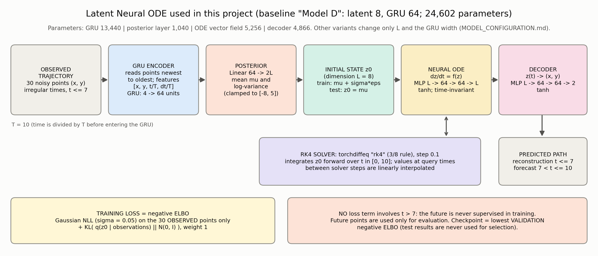

# Model architecture

Variational Latent Neural ODE as implemented in `src/glo/model.py`, `solver.py` and `pipeline.py`. Parameter counts are measured by instantiating the model. Adapted from the verified project material; values are from the code, not from the original paper.

## Complete architecture (verified from `src/glo/model.py`, `solver.py`, `pipeline.py`)

**Pipeline:** Observed trajectory -> GRU encoder -> initial latent state -> Neural ODE -> RK4 solver -> decoder -> predicted trajectory.




### Component summary (baseline Model D: latent L = 8, GRU width H = 64)

| # | Component | Input | Output | Formulation | Implementation | Parameters |
|---|---|---|---|---|---|---:|
| 1 | GRU encoder | 30 observations, newest first: [x, y, t/T, dt/T], shape [batch, 30, 4] | final hidden state, 64 numbers | h_k = GRU(h_(k-1), input_k) | `nn.GRU(input_size=4, hidden_size=H, batch_first=True)` | 13,440 |
| 2 | Posterior layer | hidden state (64) | mean mu (8) and log-variance (8, clamped to [-8, 5]) | (mu, log sigma^2) = W h + b | `nn.Linear(H, 2L)` | 1,040 |
| 3 | Initial latent state | mu, log-variance | z0 (8) | z0 = mu + sigma*eps, eps ~ N(0, I) in training; z0 = mu in evaluation | reparameterisation in `LatentODE.forward` | 0 |
| 4 | Neural ODE vector field | z (8) | dz/dt (8) | dz/dt = f(z), time-invariant | MLP 8 -> 64 -> 64 -> 8, tanh | 5,256 |
| 5 | RK4 solver | z0, query times | z(t) at the query times | numerical integral of f | torchdiffeq `odeint`, method `rk4`, step 0.1 | 0 |
| 6 | Decoder | z(t) (8) | (x, y) at each time | (x_hat, y_hat) = g(z(t)) | MLP 8 -> 64 -> 64 -> 2, tanh | 4,866 |
| | **Total** | | | | | **24,602** |

Coordinates are normalised with the training-set mean and scale before entering the model and de-normalised before any error is computed. All results are in the original coordinate units.

### How the components connect

1. The encoder reads only the 30 noisy observations (never anything after t = 7) and summarises them in 64 numbers.
2. The posterior layer turns those numbers into a Gaussian distribution over the 8-dimensional initial latent state.
3. A sample (or the mean, at test time) is the starting point of the latent ODE.
4. The ODE solver integrates the learned rate-of-change network forward through t in [0, 10], giving a latent state at every requested time.
5. The decoder maps each latent state to an (x, y) point. Times t <= 7 give the reconstruction, times 7 < t <= 10 give the forecast.

### Training versus evaluation

| | Training | Evaluation |
|---|---|---|
| Initial state | sampled: z0 = mu + sigma*eps | posterior mean z0 = mu (deterministic) |
| Query grid | 100 times in [0, 10] | 200 times in [0, 10] |
| Observations | new random 30 times every batch | fixed draw (observation seed 123), identical for all models |
| Loss | negative ELBO on observed points | RMSE against the clean true path |

### Parameter counts for every configuration used

| Model | Latent L | GRU width H | GRU encoder | Posterior layer | ODE vector field | Decoder | Total |
|---|---|---|---|---|---|---|---|
| Original-size configuration (hidden 25/20/20, one hidden layer) | 4 | 25 | 2,325 | 208 | 184 | 142 | 2,859 |
| A (baseline Model D) | 8 | 64 | 13,440 | 1,040 | 5,256 | 4,866 | 24,602 |
| B | 16 | 64 | 13,440 | 2,080 | 6,288 | 5,378 | 27,186 |
| C | 8 | 128 | 51,456 | 2,064 | 5,256 | 4,866 | 63,642 |
| D | 16 | 128 | 51,456 | 4,128 | 6,288 | 5,378 | 67,250 |
| Large (capacity study) | 32 | 128 | 51,456 | 8,256 | 8,352 | 6,402 | 74,466 |

(Counts were obtained by instantiating the model classes with each configuration, without training; they match the counts stored in the checkpoints: 24,602 / 27,186 / 63,642 / 67,250 / 74,466.) Original-size row: counted the same way; **not** a result from a trained run.

### Conditioned variant (an experimental extension; not the main model)

The dynamics-conditioned model M3 adds a 4-dimensional code c = tanh(W_c h) from the encoder and uses dz/dt = f(z, c), dc/dt = 0 (25,118 parameters); see `06_EXPERIMENTAL_RESULTS/CONDITIONING_EXPERIMENTS.md`.

## GRU encoder (verified from `src/glo/model.py::RecognitionGRU`)

**What it does.** Reads the sparse, noisy, irregularly timed observations and summarises them into one vector that describes the whole path.
**Why it is needed.** The Neural ODE needs a starting latent state; the encoder is what turns raw observations into that starting state. A GRU (gated recurrent unit) is a recurrent network, so it can read a sequence of any length.

| Item | Verified value |
|---|---|
| Input per observation | 4 features: x, y, t/T, dt/T (T = 10, the last query time) |
| Sequence length | 30 observations |
| Processing direction | **backwards in time**: the sequence is flipped, so the newest observation is read first and the earliest (t = 0) last |
| Network | one-layer unidirectional `nn.GRU(4, H)`, H = 64 (baseline) or 128 |
| Output used | the final hidden state (after reading the earliest observation), H numbers |
| Parameters | 3H(4 + H + 2) = 13,440 for H = 64; 51,456 for H = 128 |

**How irregular timestamps are represented.** Each observation carries its own time: t/T (where the point lies on the timeline) and dt/T (the gap to the neighbouring observation in the reading order, 0 for the first one read). So the network sees the actual spacing, not just the order. Observation times are not required to be equally spaced.

**How the posterior over z0 is obtained.** The final hidden state goes through a linear layer (H -> 2L) that outputs the mean and the log-variance of a Gaussian over z0 (see `LATENT_SPACE.md`).

**Mathematical form.** For observations (x_1, t_1) ... (x_N, t_N), reading from the newest: h_k = GRU(h_(k-1), [x_k, t_k/T, dt_k/T]); the code then uses the last h. The GRU's gates (update and reset) are the standard GRU equations.

**Connection to the next component.** The 64-number summary feeds the posterior layer.

**Comparison with the paper.** The paper's recognition network is "an RNN, which consumes the data sequentially backwards in time" with 25 hidden units (cell type not stated). Adding the time features is our design choice.

## Latent space and the initial latent state (verified from `model.py` and `pipeline.py`)

| Item | Verified value |
|---|---|
| Latent dimension L | 8 (baseline); 16 and 32 in the size studies; 4 in the original-size configuration |
| Distribution | diagonal Gaussian q(z0 | observations) = N(mu, diag(sigma^2)) |
| Mean and log-variance | produced by `nn.Linear(H, 2L)` from the GRU's final hidden state; log-variance clamped to [-8, 5] |
| Prior | standard normal N(0, I) |
| Reparameterisation (training) | z0 = mu + exp(0.5 * log-variance) * eps, eps ~ N(0, I) |
| Evaluation | z0 = mu (the posterior mean; deterministic) |
| KL term | KL(q || N(0, I)) = 0.5 * sum( mu^2 + exp(logvar) - 1 - logvar ), averaged over the batch; weight 1.0, no annealing in the main runs |

**What the latent state means.** It is a short list of numbers that the model invents to describe "which path is this and where is it now". It is not given a physical meaning by us, and we do **not** claim it is disentangled or interpretable.

**Why the reparameterisation trick.** Sampling directly is not differentiable; writing the sample as mu + sigma*eps moves the randomness to eps so gradients reach mu and sigma.

**Why a distribution rather than one point.** The model is a variational auto-encoder: the KL term keeps the latent codes close to a simple prior, which is part of the training objective (negative ELBO).

**Connection.** z0 is the starting point of the Neural ODE.

## Neural ODE dynamics (verified from `src/glo/model.py::LatentDynamics`)

| Item | Verified value |
|---|---|
| Input / output | latent state z (L numbers) -> rate of change dz/dt (L numbers) |
| Network | MLP: Linear(L, 64) - tanh - Linear(64, 64) - tanh - Linear(64, L) (two hidden layers of 64 units) |
| Activation | tanh |
| Time dependence | **time-invariant (autonomous)**: the function ignores t, as in the paper |
| Parameters | 5,256 (L = 8); 6,288 (L = 16); 8,352 (L = 32) |
| Hidden width held fixed | 64 in every size study (so most added capacity is in the encoder) |

**Formulation.** dz(t)/dt = f_theta(z(t)); z(t) = z0 + integral from 0 to t of f_theta(z(s)) ds.

**How are the latent dynamics learned?** Only through the training loss: the decoded latent path must match the 30 observed points. Gradients flow back through the solver steps into the vector field. Nothing in the loss involves t > 7, so the future part of the path is an extrapolation of the learned vector field, not something it was directly trained to match.

**Why time-invariant?** A time-invariant field means the latent state alone determines the future, which is the paper's formulation and keeps the model simple. (A limitation: the model must express any dependence on time through the state itself.)

**Connection.** The solver repeatedly evaluates this network to move z forward in time.

## RK4 solver (verified from `src/glo/solver.py`, the installed torchdiffeq 0.2.5 source, and `audit/verify_2_solver.py`)

| Item | Verified value |
|---|---|
| Library / call | `torchdiffeq.odeint` with `method = 'rk4'`, `options = {'step_size': 0.1}`; `adjoint = False` (direct backpropagation through the steps) |
| Method actually used | torchdiffeq's `rk4` is the **Runge-Kutta 3/8 rule**, a fourth-order method (not the "classical" 1/6-weights RK4) |
| One step (step size h) | k1 = f(y0); k2 = f(y0 + h*k1/3); k3 = f(y0 + h*(k2 - k1/3)); k4 = f(y0 + h*(k1 - k2 + k3)); y1 = y0 + h*(k1 + 3*(k2 + k3) + k4)/8 |
| Step size | 0.1 over t in [0, 10] -> 100 steps, 400 function evaluations per trajectory batch (log shows `nfe/b = 400`) |
| Time grid | uniform solver grid of spacing 0.1; training queries 100 times, evaluation queries 200 times in [0, 10] |
| Off-grid query times | torchdiffeq evaluates the solution on its own 0.1 grid and **linearly interpolates** to query times that fall between steps |
| Offline fallback | a classical RK4 is included for machines without torchdiffeq; it was **not** used for the reported runs (checkpoints record `torchdiffeq`) |

**Why a solver?** The latent state at time t is the integral of a neural network; there is no formula, so it is computed step by step.

**Measured accuracy (checked in this project, `audit/verify_2_solver.py`).** On a test oscillator the error falls by a factor of 16.1 each time the step is halved (fourth order) at times that lie on the solver grid. At off-grid query times the linear interpolation dominates and the error falls only about 4x per halving (second order; 2.7e-3 at step 0.1 on that test problem). For the trained models the effect is small: per-trajectory RMSE changes by about 1.4e-4 to 2.6e-4 on average (maximum 1.2e-3) between rk4 at step 0.1, rk4 at step 0.025 and a tight dopri5 solver, which is negligible against the RMSE differences reported (0.03 to 0.5).

**Recommended wording:** "fixed-step fourth-order Runge-Kutta (3/8 rule), step 0.1, with linear interpolation to query times"; avoid "classical RK4" and avoid implying the paper's adaptive solver and adjoint were used.

**Connection.** The solver output z(t) at the query times is passed to the decoder.

## Decoder (verified from `src/glo/model.py`)

| Item | Verified value |
|---|---|
| Input | latent state z(t), L numbers (8 in the baseline) |
| Network | MLP: Linear(L, 64) - tanh - Linear(64, 64) - tanh - Linear(64, 2) |
| Output | 2 numbers per time: the normalised x and y coordinates, de-normalised with the training-set mean and scale |
| Parameters | 4,866 (L = 8); 5,378 (L = 16); 6,402 (L = 32) |

**What it does.** Turns the latent state at each requested time into a point in the plane; the sequence of points over time is the predicted trajectory.

**Why it is needed.** The latent space is abstract; the decoder connects it to the observable (x, y) data and defines the likelihood used for training.

**Likelihood.** The decoder output is the mean of a Gaussian with fixed standard deviation 0.05 (data units); no variance is predicted.

**Connection.** Decoded points at t <= 7 are scored as reconstruction; points at 7 < t <= 10 as forecast.

## Training objective (verified from `src/glo/pipeline.py::batch_objective` and `scripts/02_train_model.py`)

**Loss = negative ELBO = reconstruction negative log-likelihood + KL divergence.**

```
NLL  = sum over the 30 OBSERVED points and the 2 coordinates of  [ 0.5 * ((prediction - observation)/s)^2 + log s + 0.5 * log(2 pi) ],   s = 0.05 / data_scale
KL   = 0.5 * sum over latent dims of ( mu^2 + exp(logvar) - 1 - logvar )                               (posterior vs standard normal prior)
loss = mean over the batch of ( NLL + 1.0 * KL )
```

| Question | Answer (verified) |
|---|---|
| Reconstruction likelihood | Gaussian, fixed sigma = 0.05 in data units (divided by the data scale because inputs are normalised) |
| Which points are supervised? | **Only the 30 observed noisy points** (`supervision = observed`) |
| Are future points directly supervised? | **No.** No term involves t > 7, and the unobserved context points are also not supervised. Forecasting is an extrapolation of the learned dynamics. A separate option `full_clean` (clean dense targets) exists in the code but was **never run**. |
| KL weight | 1.0; no annealing in the reported runs |
| Observation noise | the stored noisy values are used; the same noise realisation per trajectory every epoch (only the subset of observed times changes) |
| Validation | posterior-mean z0, the same fixed observation draws every epoch (generator seeded with `seed + 999`), full negative ELBO |
| Checkpoint selection | the epoch with the **lowest validation negative ELBO**; validation forecast RMSE is logged each epoch but never used for selection; test results are never used |
| Optimiser | Adam; learning rate 3e-3 with cosine annealing to 1e-5; gradient-norm clipping 1.0 |

**Why this matters for interpretation.** The model is rewarded for matching the observed points. How well it forecasts the future is a by-product. This is one plausible reason why forecasting can be hard to improve, but it is a **hypothesis that has not been tested** (the `full_clean` supervision experiment was not run).

## Model configurations (verified from `configs/*.yaml` and checkpoint metadata)

### Baseline "Model D" (`configs/model_d.yaml`, used unchanged for all validation experiments)

```
latent_dim 8, encoder_hidden (GRU) 64, dynamics_hidden 64 (2 layers), decoder_hidden 64 (2 layers), tanh
solver rk4, step_size 0.1, adjoint false
epochs 300, batch_size 32, n_query 100 (training grid), n_obs 30
optimizer Adam, lr 0.003, cosine schedule to 1e-05, grad_clip 1.0, patience 60 (early stopping did not trigger in the checked runs)
supervision observed, sigma 0.05, kl_weight 1.0, kl_anneal_epochs 0
seed 42, device cpu, threads 4
```

### All configurations used

| Model | Latent L | GRU width H | GRU encoder | Posterior layer | ODE vector field | Decoder | Total |
|---|---|---|---|---|---|---|---|
| Original-size configuration (hidden 25/20/20, one hidden layer) | 4 | 25 | 2,325 | 208 | 184 | 142 | 2,859 |
| A (baseline Model D) | 8 | 64 | 13,440 | 1,040 | 5,256 | 4,866 | 24,602 |
| B | 16 | 64 | 13,440 | 2,080 | 6,288 | 5,378 | 27,186 |
| C | 8 | 128 | 51,456 | 2,064 | 5,256 | 4,866 | 63,642 |
| D | 16 | 128 | 51,456 | 4,128 | 6,288 | 5,378 | 67,250 |
| Large (capacity study) | 32 | 128 | 51,456 | 8,256 | 8,352 | 6,402 | 74,466 |

| Study | Models | What changes |
|---|---|---|
| Original-size run (E1) | latent 4, GRU 25, MLP 20 x 1 hidden layer | smaller architecture, lr 1e-3 in the first comparison |
| Shared vs specialist | Model D | trained on both families (shared) or one family (specialist) |
| Three-family / five-family | Model D | training data only |
| Conditioning | M1 24,602; M2 25,049 (dynamics width 67); M3 25,118 (code c in R^4); M2aug 25,894 (latent 12) | extra code / extra latent dimensions |
| Capacity scaling | baseline 8/64, medium 16/128, large 32/128 | latent and GRU width together; ODE and decoder widths unchanged |
| Controlled 2x2 | A 8/64, B 16/64, C 8/128, D 16/128 | latent dimension and GRU width separately; same data stream (`data_seed` 42) |

In every size study the ODE vector field and decoder keep 64 hidden units, so the added parameters are mostly in the GRU encoder.
