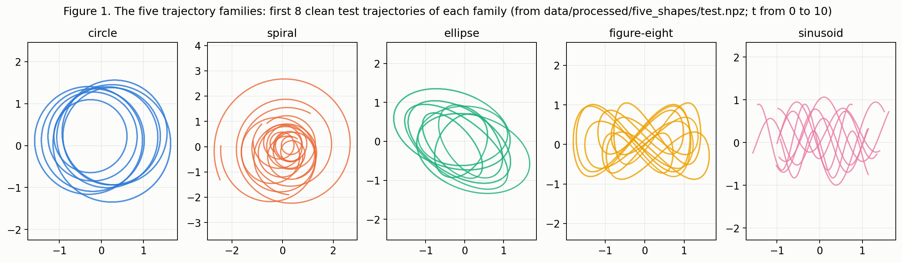

# Datasets

Synthetic trajectory families (generated deterministically by `scripts/01_generate_dataset.py` and `scripts/30_generate_five_shapes.py`) and the GeoLife evaluation data (not distributed).

## Dataset overview (verified from `data/processed/*/metadata.json`, `src/glo/data.py`, `src/glo/five_shapes.py`, and `audit/verify_1_datasets.py`)

All data are **synthetic**, generated from known equations, so the true path is known everywhere (including the future) and can be used for evaluation. Real GPS data (GeoLife) are used only in the transfer experiments (not distributed; see `GEOLIFE_TRANSFER.md`).

### Five trajectory families

| # | Family | What the motion looks like |
|---|---|---|
| 0 | circle | constant-radius loop |
| 1 | spiral | loop whose radius grows or shrinks exponentially |
| 2 | ellipse | stretched loop at a random orientation |
| 3 | figure-eight | a path crossing itself in an "8" |
| 4 | sinusoid | a sine wave drifting along x |

### Verified statistics

| Item | Value |
|---|---|
| Total trajectories (five-family set) | 5,000 (1,000 per family) |
| Time points per trajectory | 200 equally spaced times on [0, 10] (spacing 10/199 = 0.0503) |
| Noise | Gaussian, SD 0.05 added to x and y (clean paths kept for evaluation) |
| Observed interval | t <= 7 (30 observations) |
| Forecast interval | 7 < t <= 10 |
| Split | per family 700 / 150 / 150 -> train 3,500 / validation 750 / test 750 (70% / 15% / 15%) |
| Generation seed | 42 (per-family generator seed = 42 + 1009*(family id + 1)) |
| Related datasets | two-family: circle + spiral (1,400 / 300 / 300); three-family: + ellipse (2,100 / 450 / 450) |
| Relationship | the five-family set contains the three-family trajectories **unchanged**, with the same train/validation/test membership (array-for-array identical) |
| Leakage checks (re-verified) | no trajectory id and no identical path appears in more than one split; observations are only at t <= 7 |

**Figures:** `07_FIGURES/DATASETS/` (all five families, parameter variations (illustration), regular vs irregular sampling, observed vs forecast interval, split organisation).

## Trajectory generation: equations, parameters and ranges (verified from the generation code and metadata)

Common random draws for circle, spiral and ellipse (`src/glo/data.py::sample_trajectory`): radius R ~ U(0.55, 1.5); angular speed omega = s * U(0.75, 1.45) with random sign s = +/-1 (rotation direction); phase phi ~ U(-pi, pi); centre (cx, cy) ~ U(-0.35, 0.35)^2. The angle is theta(t) = omega*t + phi.

| Family | Equation | Parameters and ranges |
|---|---|---|
| circle | x = cx + R cos(theta), y = cy + R sin(theta) | R in [0.55, 1.5]; omega in +/-[0.75, 1.45]; phi in [-pi, pi]; centre in [-0.35, 0.35]^2 |
| spiral (logarithmic) | r(t) = R exp(g t); x = cx + r(t) cos(theta), y = cy + r(t) sin(theta) | as circle, plus growth rate g = +/- U(0.055, 0.12) (positive = expanding, negative = contracting) |
| ellipse | x = cx + cos(alpha) a cos(theta) - sin(alpha) b sin(theta); y = cy + sin(alpha) a cos(theta) + cos(alpha) b sin(theta) | semi-major a in [0.85, 1.65]; semi-minor b = a * U(0.40, 0.78); orientation alpha in [0, pi]; omega, phi, centre as above |
| figure-eight | x = cx + A sin(theta), y = cy + B sin(2 theta) | A in [0.85, 1.5], B in [0.45, 1.0], abs(omega) in [0.75, 1.45] with random sign, phi in [-pi, pi], centre in [-0.35, 0.35] |
| sinusoid | x = x0 + v t, y = cy + A sin(omega t + phi), x0 = cx - 5v | A in [0.4, 1.0], omega in [0.75, 1.45], abs(v) in [0.2, 0.3] with random sign (drift direction), phi in [-pi, pi], centre in [-0.35, 0.35]; x0 = cx - 5v centres the path on cx over t in [0, 10] |

**Meaning of the parameters (simple English).** R / A / B = size of the loop or wave; omega = how fast it turns (sign = clockwise or counter-clockwise); phase = where on the loop it starts; centre = where on the plane it sits; growth g = how fast a spiral expands or contracts; a, b, alpha = the two radii and the tilt of an ellipse; v = the sideways drift speed of the sinusoid.

**How generation works.** For each family, a generator seeded as 42 + 1009*(id + 1) draws the parameters of 1,000 trajectories in turn, evaluates the equation on the 200-point time grid, adds Gaussian noise (SD 0.05) to make the noisy copy, and finally shuffles the 1,000 trajectories into 700 / 150 / 150 for train / validation / test. The circle, spiral and ellipse arrays in the five-family set are copied unchanged from the three-family set (checked array by array).

**Shape checks (saved in `results/five_shapes/dataset_checks.json`, no failures).** Figure-eight: all 1,000 cover a full eight with alternating centre crossings (largest vertical offset at a centre crossing 3.7e-05 of B; median y-to-x zero-crossing ratio 2.0). Sinusoid: all 1,000 have monotone x and the y half-range equals the amplitude (ratio 0.9994 to 1.0000).

**Note on illustrations.** `fig2_parameter_variations_illustration.png` is drawn from these equations with hand-chosen parameter values; it illustrates the meaning of parameters and is **not** experimental data.

## Irregular observation sampling (verified from `src/glo/pipeline.py::prepare_batch` and the saved evaluation observations)

**Procedure (every batch, and at evaluation).**

1. The model works on a query grid of times (100 times during training, 200 during evaluation; equally spaced indices of the 200-point trajectory).
2. Only grid times with t <= 7 are allowed as observation times (about 70 of 100 in training; 140 of 200 in evaluation).
3. The first observation is **always at t = 0** (index 0). The other 29 are drawn **at random without replacement** from the remaining allowed times (random ranks, top-29), then sorted in time.
4. The observed values are the stored **noisy** coordinates at those times; the encoder receives them together with their (normalised) times and gaps.
5. **Training:** a fresh random subset is drawn for every trajectory in every batch. **Evaluation:** one fixed draw (observation seed 123), identical for every model compared.

**What the saved evaluation shows** (750 test trajectories, 30 observations each): 750 distinct sets of observation times; gaps between consecutive observed times from 0.05 to 2.16 (mean 0.23); all times are multiples of the 0.05 grid; the latest observed time is 6.985 (< 7). So the sampling is irregular in spacing but discretised to the dataset's grid, and it always includes t = 0.

**What is held out.** The 110 other context times (t <= 7, not observed) are used to score reconstruction; all 60 times with t > 7 are used to score the forecast.

**Related finding.** Models trained with exactly 30 observations work only near that count (validation reconstruction RMSE 0.061 at 30 observations but 0.494 at 20, 0.363 at 40 and 0.595 at 50; `results/validation/nobs_ablation`).

Figures: `07_FIGURES/DATASETS/fig3_regular_vs_irregular_sampling.png`, `fig4_observed_vs_forecast_interval.png`.

## Train / validation / test split (verified)

| Dataset | Train | Validation | Test | Per family (train / val / test) |
|---|---:|---:|---:|---|
| two-family | 1,400 | 300 | 300 | 700 / 150 / 150 |
| three-family | 2,100 | 450 | 450 | 700 / 150 / 150 |
| five-family | 3,500 | 750 | 750 | 700 / 150 / 150 |

- **Ratio:** 70% / 15% / 15%, stratified by family (the same proportions in each family).
- **Purpose:** *train* = fit the weights and the normalisation; *validation* = choose the checkpoint (and, earlier, the configuration); *test* = final scores only.
- **No leakage (independently re-verified in this project):** zero overlap of trajectory ids between splits, zero identical paths across splits, nearest-neighbour path distances from test to train as large as between training trajectories, and observation times only at t <= 7.
- **Nesting:** the two-family, three-family and five-family sets share the same circle / spiral / ellipse trajectories and split membership (array-for-array identical where they overlap).
- **GeoLife (real data):** splits are by **user** (30% development users; held-out test users), 1,000 test segments from 97 users; development users were further split into training and validation users for the GeoLife-trained models. Test users were never used for training or selection.

Figure: `07_FIGURES/DATASETS/fig5_dataset_split_organisation.png`.

## Data preprocessing (verified from `data.py`, `pipeline.py`, `metadata.json`)

1. **Storage.** Each split is saved as `train.npz`, `val.npz`, `test.npz` with arrays: time (200), clean xy, noisy xy, family id, trajectory id, parameters, and a stored default observation mask (not used by the training or evaluation code; used only by the leakage validator).
2. **Normalisation.** Coordinates are normalised as (xy - mean) / scale, with mean and scale computed **from the training split only** (scale = root-mean-square deviation from the mean over all coordinates). Values: five-family mean [0.00055, 0.00429], scale 0.79437; three-family scale 0.85256; two-family scale 0.89032. Each model is evaluated with the constants of the dataset it was trained on.
3. **Time scaling.** Time enters the encoder as t/T with T = 10.
4. **Observation selection.** See `IRREGULAR_OBSERVATIONS.md`.
5. **Targets.** Clean (noise-free) paths on the full grid are the evaluation targets; they are never shown to the encoder.
6. **Noise.** The noisy copy is generated once and stored, so each trajectory's noise realisation is fixed; only *which* times are observed changes between batches.
