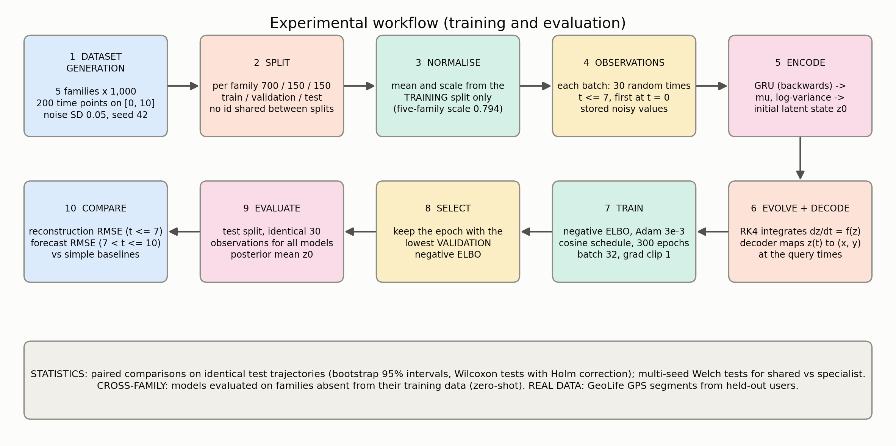

# Methodology

Training, validation, reconstruction and forecasting protocol. Test data are never used to select checkpoints or settings.

## Complete methodology (the research workflow)

| Step | What is done | Where verified |
|---|---|---|
| 1 Dataset generation | five families x 1,000 trajectories, 200 time points on [0, 10], noise SD 0.05, seed 42 | `data.py`, `five_shapes.py`, `scripts/01, 30` |
| 2 Training / validation / test split | 700 / 150 / 150 per family, stratified; no id shared | `validate_dataset`, audit |
| 3 Normalisation | mean and scale from the training split only | `metadata.json` |
| 4 Irregular observation sampling | 30 random times with t <= 7, first at t = 0 | `prepare_batch` |
| 5 Input preparation | features [x, y, t/T, dt/T], newest first | `RecognitionGRU` |
| 6 GRU encoding | final hidden state -> mean, log-variance | `model.py` |
| 7 Initial latent state | z0 = mu + sigma*eps (train), mu (test) | `model.py` |
| 8 Continuous-time evolution | RK4 integration of dz/dt = f(z) | `solver.py` |
| 9 Coordinate decoding | MLP maps z(t) to (x, y) | `model.py` |
| 10 Training objective | negative ELBO on observed points + KL | `batch_objective` |
| 11 Model training | Adam, cosine learning rate, 300 epochs | `scripts/02_train_model.py` |
| 12 Checkpoint selection | lowest validation negative ELBO | training script |
| 13 Reconstruction evaluation | RMSE on unobserved context points (t <= 7) | `evaluation.py` |
| 14 Forecast evaluation | RMSE on 7 < t <= 10 | `evaluation.py` |
| 15 Cross-family evaluation | test on families absent from training (zero-shot) | `scripts/10, 31` |
| 16 Statistical comparison | paired bootstrap, Wilcoxon, Holm; Welch across seeds | `scripts/09, 32, 33` |

**Reconstruction vs forecasting evaluation.** *Reconstruction* asks: inside the period where the model has seen some points, how well does it fill the gaps (110 unobserved times)? It is an interpolation problem and is what the training loss directly encourages. *Forecasting* asks: how well does it predict a period it has never seen (60 times with t > 7)? It is an extrapolation problem and is not directly trained. They are always reported **separately**, and never mixed into one number.

**Fairness rules used.** Identical observations (times and noise) for every model in a comparison (asserted in the evaluation scripts); each model normalised with its own training constants; test split never used for selection; checkpoints unchanged during evaluation (SHA-256 checked).

## Training procedure (verified from `scripts/02_train_model.py`, configs, training histories and logs)

| Setting | Verified value |
|---|---|
| Optimiser | Adam |
| Learning rate | 3e-3, cosine annealing to 1e-5 over the 300 epochs (the first comparison of the original-size model used 1e-3) |
| Batch size | 32 |
| Epochs | 300 (early stopping with patience 60 never triggered in the runs checked) |
| Optimiser steps | 110 per epoch for five-family data (3,500 / 32, last batch partial) = **33,000**; 66 per epoch for the three-family model = 19,800; two-family 44 per epoch |
| Gradient clipping | norm 1.0 |
| Loss | negative ELBO, sigma 0.05, KL weight 1.0 |
| Training query grid | 100 times; 30 observations per trajectory, redrawn every batch |
| Random seeds | 42 for most runs; 123, 2024, 2025, 2026 added for the two-family multi-seed studies; the 2x2 ablation additionally fixes `data_seed` 42 (separate generators for batch order and observation draws) |
| Solver | torchdiffeq `rk4`, step 0.1, no adjoint |
| Hardware | CPU only: AMD EPYC 7313 (16 cores, 32 threads), 125 GB RAM; 4 threads per run; PyTorch 2.5.1, torchdiffeq 0.2.5, Python 3.12.4 |
| Run time | about 16-17 s per epoch; 78 min (earlier 8/64 run), 80 min (16/128), 84 min (32/128); 80.6 to 81.5 min for the four ablation cells (several runs executed in parallel) |
| Checkpoint | saved whenever the validation negative ELBO improves; the last saved one is the selected checkpoint (epochs 294-299 of 300 in the ablation) |
| Per-epoch log | training and validation loss (NLL and KL), validation context and forecast RMSE, gradient norms, function evaluations, seconds |

**Not converged.** In the 2x2 ablation the selected epochs are 294-299 of 300 and the validation loss was still falling slowly, so the models are not fully converged.

## Evaluation metrics (verified from `src/glo/pipeline.py::infer_test_metrics`, `evaluation.py`)

All metrics are computed in **original coordinate units** after de-normalising predictions, **per trajectory**, and then averaged over trajectories.

| Metric | Definition | Interval |
|---|---|---|
| **Reconstruction RMSE** | sqrt( sum of squared (x, y) errors over the context times that were **not** observed / (2 * number of such times) ) | t <= 7, 110 unobserved times of 140 |
| **Forecast RMSE** | sqrt( mean over the future times and both coordinates of the squared error ) | 7 < t <= 10 (60 times) |
| Also available (not used for headline results) | forecast MAE, ADE (average displacement), FDE (final displacement), Chamfer distance | |

**Aggregation.** Tables report the **mean (and median, SD) of per-trajectory RMSE**. A different quantity, the *pooled* RMSE (square root of the mean squared error over all points of all trajectories), is stored separately and is never mixed with the per-trajectory mean.

**Baselines.** *Linear interpolation* of the 30 observed points (reconstruction); *hold-last* = stay at the last observed point; *constant velocity* = extrapolate the velocity of the last two observations (forecast). Both baselines see exactly the same observations as the models.

**Statistics.** Paired differences on identical trajectories and observations: bootstrap 95% intervals (resampling test trajectories), Wilcoxon signed-rank test, Holm correction for many comparisons. Across training seeds: mean +/- SD with a Student-t 95% interval, Welch t-test for shared vs specialist. **Important:** trajectory-level intervals and p-values describe only the variation across test trajectories for the specific trained models; they do not describe variation across training runs.

**GeoLife.** Median per-segment RMSE in metres at the recorded timestamps against the recorded GPS positions; user-cluster bootstrap intervals.

## Experimental configurations (what was run, under which conditions)

| ID | Experiment | Data | Models | Seeds | Training budget | Test protocol | Evidence |
|---|---|---|---|---|---|---|---|
| E1 | Failure diagnosis; original-size vs Model D | two-family | original-size (latent 4, GRU 25), candidates B-D | 42 | 300 epochs | validation split for selection; test once | single run |
| E2 | Reproducibility of Model D | two-family | Model D | 42, 123, 2024, 2025, 2026 | 300 epochs | 300 test trajectories | multi-seed |
| E3 | Shared vs specialist | two-family | shared Model D; circle-only and spiral-only specialists | shared 5; specialists 3 (42, 123, 2024) | shared 1,400 x 300 epochs; specialists 700 x 600 (same steps) | circle/spiral test (150 each) | multi-seed |
| E4 | Three families; two-family models on unseen ellipses | three-family | three-family model; five two-family models | 3-family 42; two-family 5 | 300 epochs | 450 test (150 ellipses) | multi-seed (ellipse test) |
| E5 | Conditioning | two-family | M1, M2, M3 (5 seeds), M2aug (3 seeds) | 42, 123, 2024, 2025, 2026 | 300 epochs; `data_seed` = seed | 300 test | multi-seed |
| E6 | Observation count | two-family | Model D | 42 | - | validation split, 5 to 100 observations | single run |
| E7-8 | GeoLife | real GPS | frozen three-family model; GeoLife-trained (scratch, fine-tuned) | 42 | 300 epochs | 1,000 held-out segments, 97 users | single run |
| E9 | Five-family experiment | five-family | frozen three-family model; five-family Model D | 42 | 33,000 steps (five) vs 19,800 (three) | 750 test | single run |
| E10 | Capacity scaling | five-family | 8/64, 16/128, 32/128 | 42; `data_seed` unset | 33,000 steps | 750 test | single run |
| E11 | Controlled 2x2 | five-family | A, B, C, D | 42 with `data_seed` 42 | 33,000 steps | 750 test, identical observations | single run |

**Do not assume the experiments were run under identical conditions** (see `02_EXISTING_RESEARCH/ORIGINAL_VS_OUR_IMPLEMENTATION.md`).
